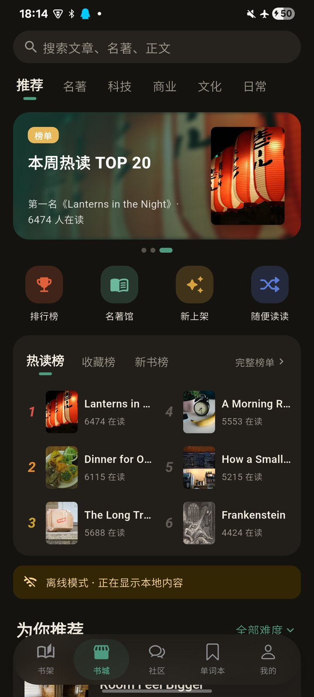
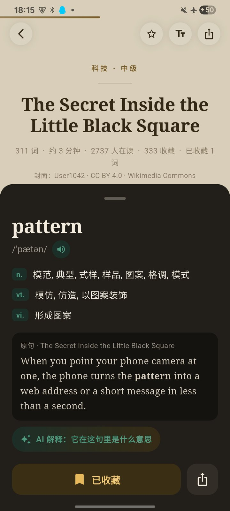
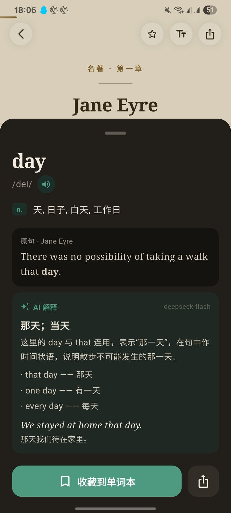
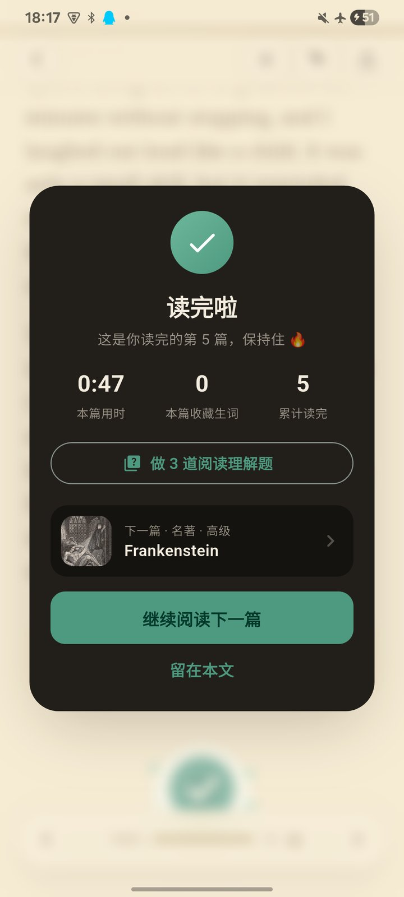

# 拾读 Glean

离线优先的英语阅读学习 App（Flutter，Android 真机；同一份代码另出 H5 版）。按分类和难度读短文与名著选章，长按取词收藏到单词本，随时从书架回到上次的位置；断网也能完成「列表 → 阅读 → 取词收藏 → 进度落库」整条链路，联网后自动同步。

- 代码：`lib/`（70 多个文件），测试：`test/`（`fvm flutter test`，全部通过）
- 设计参考页：`../docs/design/ui-reference.html`（iOS 风格，含 4 项动效的可交互演示）、`../docs/design/redesign-v2.html`（五个 Tab 的结构与暖灰白卡配色）

**演示**（三星 S21 Ultra 真机，release 包；2、3 为飞行模式）：

| 书架 | 飞行模式 · 书城 | 飞行模式 · 取词收藏 | AI 解释 | 读完庆祝 |
|---|---|---|---|---|
|  |  |  |  |  |

动效录屏（18 秒：翻书转场 → 右滑合上 → 长按取词 → 收藏弹跳 → 读完庆祝）：[docs/media/demo.mp4](docs/media/demo.mp4)


**底栏五个 Tab**：

| Tab | 内容 |
|---|---|
| 书架 | 继续阅读卡；全部 / 在读 / 收藏 / 稍后 / 读完筛选（带数量）；封面网格（最近活动在前，封面角标进度或「读完」，金星=收藏，长按收藏 / 稍后再读）；书架为空时推荐「大家都在读」 |
| 书城 | 搜索；分类文字 Tab；自动轮播 banner（名著共读月 / 新上架 / 本周热读，本地数据生成，离线可用）；排行榜 / 名著馆 / 新上架 / 随便读读四个入口；热读榜 / 收藏榜 / 新书榜卡片（前 6 名双列）与完整榜单页；推荐列表（难度筛选、分页、下拉刷新） |
| 社区 | 读后分享：英文原句 + 中文感想 + 来源文章；推荐 / 最新 / 我的；帖子下露出热评，详情页可评论、回复某人、给评论点赞；从收藏词的原句发帖 |
| 单词本 | 待复习数的复习卡；本周新增 / 认识 / 已掌握；搜索；新词 / 认识 / 已掌握筛选（带数量）；左滑删除可撤销；点词跳回原文并闪烁 |
| 我的 | 头像与资料编辑；读完 / 生词 / 累计时长 / 连续天数；收藏、稍后再读、阅读历史、我的动态入口；今日目标环与周打卡；阅读设置、主题、提醒、同步、埋点调试 |
- 内容与图片来源：[content/SOURCES.md](content/SOURCES.md)、[content/COVER_CREDITS.md](content/COVER_CREDITS.md)

## 目录

1. [技术选型](#1-技术选型)
2. [本地启动](#2-本地启动)
3. [架构](#3-架构)
4. [本地数据库：建表、索引与迁移](#4-本地数据库建表索引与迁移)
5. [离线、幂等与同步](#5-离线幂等与同步)
6. [动效清单](#6-动效清单)
7. [数据埋点方案](#7-数据埋点方案)
8. [AI 功能（DeepSeek）](#8-ai-功能deepseek)
9. [登录与鉴权（Mock）](#9-登录与鉴权mock)
10. [打包、签名与上架](#10-打包签名与上架)
11. [已知缺陷与优化思路](#11-已知缺陷与优化思路)

---

## 1. 技术选型

| 方面 | 选择 | 理由 |
|---|---|---|
| 跨端框架 | **Flutter 3.44.9**（FVM 锁定在 `.fvmrc`） | 自绘引擎，动效与手势在 Android/iOS 上表现一致；自定义路由、`AnimationController`、3D 变换、物理模拟（`SpringSimulation`）都是一等公民，本题 30% 的动效分可以不依赖第三方动画库完成 |
| 本地存储 | **sqflite + 手写 SQL**，辅以 `shared_preferences` | 题目要求给出建表 SQL 与迁移策略；手写 SQL 让 UPSERT、keyset 分页、幂等写入都一目了然。KV 只存设置类数据（字号、主题、难度筛选、搜索历史） |
| 状态管理 | **Riverpod 3**，只做依赖注入、设置和「数据变了」的通知（`Revision` 计数器） | 页面状态留在各自 `State` 里，避免全局 store；仓库都能在测试里替换 |
| 动效 | 原生 API：自写 `PageRoute`（翻书转场、手势返回）、`AnimationController`、`Matrix4` 透视、`CustomPainter`（彩纸、进度环） | 庆祝动画自绘，无 Lottie 资源需要授权或加载 |
| 测试 | `flutter_test` + `sqflite_common_ffi`（真实 SQLite 文件） | 仓库、迁移、同步、埋点在桌面 SQLite 上跑真实 SQL；组件测试用内存假仓库 |
| CI | GitHub Actions：format → analyze → test（含汇总脚本测试）→ `build apk --release` → `build web`，APK 与 H5 产物上传；H5 可选自动发布到 GitHub Pages | `.github/workflows/ci.yml` |

主交付 Android（minSdk 30：UPSERT 需要 SQLite ≥ 3.24，Android 11 起自带）。H5 与 App 同一份 Flutter 代码，见下节。iOS 工程可编译，未在真机验证。

## 2. 本地启动

```bash
# Flutter 版本由 FVM 锁定
fvm install
fvm flutter pub get
fvm flutter run            # 连接 Android 真机（Android 11+）
fvm flutter test           # 全部单测 / 组件测试
```

- 首次启动会把 `assets/seed/` 里的种子数据（34 篇文章、6 千多条词典）导入 SQLite，开屏期间完成，之后每次启动只读一个 19 字节的 `manifest.json` 判断是否需要重导。
- 演示账号：**demo / glean123**（登录页点提示条即可填入），也可以注册新账号。
- AI 导读、阅读理解题、CEFR 难度随种子内置，无需任何密钥。取词面板的「AI 解释」需要在构建时传入 DeepSeek 密钥（不入库）：`fvm flutter run --dart-define=DEEPSEEK_API_KEY=sk-...`；不传则该按钮隐藏，其余功能不受影响。
- 种子重建（编辑 `content/` 后）：`python -I tool/build_seed.py --ecdict path/to/ecdict.csv`。

**H5（同源构建）**

```bash
fvm flutter build web --release                     # 产物在 build/web
python -m http.server 8765 --directory build/web    # 浏览器打开 http://127.0.0.1:8765/
```

- 和 App 是同一份代码，只有平台相关的几处按条件导入替换（`if (dart.library.js_interop)`）：
  - SQLite 换成 WebAssembly 版（`sqflite_common_ffi_web`，数据存在浏览器 IndexedDB，`web/sqlite3.wasm` 随仓库提交）。建表、迁移、种子导入、同步、埋点都走同一组 SQL，刷新页面后登录态和阅读进度都在。
  - 本地通知和后台同步换成空实现，「我的」里不显示阅读提醒（浏览器关掉标签页后无法定时唤醒）。
  - 头像不能从相册选图，只用字母头像（浏览器没有可写的文件目录）。
  - DeepSeek 请求改用 `package:http`；H5 默认不注入密钥，「AI 解释」按钮隐藏，预生成的导读和理解题照常显示。
- 按窗口宽度排版（`lib/core/design/layout.dart`）：手机浏览器里和 App 一样；窗口宽度 ≥ 900 时按网页排版——底栏换成左侧导航栏，书架封面按宽度多列、书城推荐列表两列，阅读页正文限制在 720 宽居中（翻书转场放大到这一栏），二级页面居中 760 宽，两侧空白处滚轮也能滚动页面。手机屏幕到不了这个宽度，App 的排版不受影响。
- 已在本机 Edge 上走通：登录 → 书架 → 翻书打开 → 手势返回 → 长按取词 → 刷新后数据仍在。
- CI 每次都会构建 H5 并作为 Pages 产物上传；在仓库变量里设 `DEPLOY_PAGES=true`（并把 Settings → Pages 的来源设为 GitHub Actions）后，推送 main 会自动发布到 `https://<用户名>.github.io/glean/`。

## 3. 架构

```
lib/
  app/            根组件（开屏 → 登录/首页）、底栏（HomeTab）、外观、全局 provider
  core/
    analytics/    事件目录、SQLite 事件队列、上报、会话、曝光、分析查询
    db/           建表与迁移、种子导入
    design/       设计 token（纸感/经典两套配色 × 浅/深色）、主题、iOS 风格基础组件、文字 Tab / 胶囊筛选、进度环
    navigation/   手势可跟随的返回路由
    widgets/      封面、彩纸、骨架屏、渐入、收藏按钮…
  features/
    shelf/        书架（合并阅读历史与收藏 / 稍后再读）
    store/        书城、banner 轮播、排行榜
    articles/     文章仓库（分页、搜索、榜单）、列表卡片、书本封面、封面位置登记（翻书转场的起点）
    reader/       阅读页、进度会话、阅读设置、读完卡片
    vocab/        取词、单词本、复习卡片
    coread/       社区（本地 mock：帖子、评论、点赞）
    profile/      我的、编辑资料、提醒、埋点调试面板
    library/      收藏、稍后再读、阅读历史
    auth/         登录注册（mock 后端）
    sync/         同步服务与 mock 服务端
    search/       全文搜索页
```

**页面与状态**：底栏五个 Tab 放在 `IndexedStack` 里保持状态，当前 Tab 是一个 provider（空书架的「去书城」、我的 → 我的动态可以跨 Tab 跳转）；阅读页、搜索、编辑资料等推到根 Navigator 上（底栏随之隐藏）。仓库通过 Riverpod 注入；写入后 bump 对应的 `Revision`（进度、生词、文章），关心它的页面各自重新读库。

**数据流**：

```
UI ──写──▶ Repository ──SQL──▶ SQLite（dirty=1）
                                   │
                    SyncService ◀──┘  联网/回前台/改动后 3 s/每分钟
                        │  push 脏行（带 base_version）
                        ▼
                 MockSyncServer（独立 SQLite 文件，模拟 REST）
                        │  返回合并后的记录；pull 其他设备的变更
                        ▼
                 本地按同一规则合并，dirty=0 ──▶ bump Revision ──▶ 页面刷新

Analytics.track ──▶ event_queue（SQLite）──批量──▶ MockCollector ──▶ collected_events
```

## 4. 本地数据库：建表、索引与迁移

完整 DDL 在 [`lib/core/db/schema.dart`](lib/core/db/schema.dart)（版本 6）。表关系：

```
users 1─* sessions
users 1─* reading_progress *─1 articles      （PK: user_id + article_id）
users 1─* reading_segments                    （阅读时长分段，按天统计）
users 1─* vocab                                （UNIQUE: user_id + lemma，软删除墓碑）
users 1─* article_marks *─1 articles          （收藏 / 稍后再读，PK: user_id + article_id + kind）
users 1─* quiz_results                         （阅读理解作答，PK: user_id + article_id）
article_ai                                     （AI 导读 / 题目 / CEFR，随种子导入，按 article_id 查）
ai_explanations                                （在线 AI 解释的本地缓存，PK: lemma + 句子哈希）
dict / word_forms                              （词典与屈折形式 → 原形）
event_queue → collected_events / upload_log   （埋点队列、模拟数仓、上报日志）
app_meta                                       （种子版本、同步游标）
```

关键表摘录：

```sql
CREATE TABLE reading_progress (
  user_id TEXT NOT NULL,
  article_id TEXT NOT NULL REFERENCES articles(id),
  scroll_offset REAL NOT NULL DEFAULT 0,
  anchor_para INTEGER NOT NULL DEFAULT 0,   -- 段落锚点：字号变了也能恢复
  anchor_delta REAL NOT NULL DEFAULT 0,
  font_scale REAL NOT NULL DEFAULT 1,
  progress REAL NOT NULL DEFAULT 0,
  max_progress REAL NOT NULL DEFAULT 0,
  status INTEGER NOT NULL DEFAULT 0,       -- 0 未读 1 在读 2 读完
  finished_at INTEGER,
  last_read_at INTEGER NOT NULL,
  version INTEGER NOT NULL DEFAULT 0,      -- 服务端版本（同步用）
  dirty INTEGER NOT NULL DEFAULT 1,        -- 待上传
  updated_at INTEGER NOT NULL,
  PRIMARY KEY (user_id, article_id)
) WITHOUT ROWID;

CREATE TABLE vocab (
  id TEXT PRIMARY KEY, user_id TEXT NOT NULL,
  word TEXT NOT NULL, lemma TEXT NOT NULL, definition TEXT NOT NULL,
  article_id TEXT NOT NULL, para_index INTEGER NOT NULL,
  char_start INTEGER NOT NULL, char_end INTEGER NOT NULL, sentence TEXT,
  created_at INTEGER NOT NULL, updated_at INTEGER NOT NULL,
  deleted_at INTEGER,                      -- 墓碑，删除也能同步
  version INTEGER NOT NULL DEFAULT 0, dirty INTEGER NOT NULL DEFAULT 1,
  status INTEGER NOT NULL DEFAULT 0        -- v2：0 新词 1 认识 2 已掌握
);

CREATE TABLE event_queue (
  event_id TEXT PRIMARY KEY, name TEXT NOT NULL, ts INTEGER NOT NULL,
  session_id TEXT NOT NULL, seq INTEGER NOT NULL, user_id TEXT,
  params TEXT NOT NULL,                    -- JSON：业务参数 + 公共参数
  status INTEGER NOT NULL DEFAULT 0,       -- 0 待发 1 发送中 2 已发 3 放弃
  attempts INTEGER NOT NULL DEFAULT 0,
  next_attempt_at INTEGER NOT NULL DEFAULT 0,
  batch_id TEXT, created_at INTEGER NOT NULL
);
```

| 索引 | 用途 |
|---|---|
| `idx_articles_feed (category, level, published_at DESC, id DESC)` | 分类 + 难度筛选下的 keyset 分页，任意深度都是一次索引范围扫描 |
| `idx_progress_recent (user_id, last_read_at DESC)` | 「继续阅读」卡片取最近一篇 |
| `ux_vocab_user_lemma (user_id, lemma)` UNIQUE | 同一个词只收藏一次；删除后再收藏复用同一行 |
| `idx_vocab_list (user_id, deleted_at, created_at DESC)` | 单词本列表 |
| `idx_seg_day (user_id, local_day)` | 「我的」今日目标、本周打卡、连续天数 |
| `idx_eq_pick (status, next_attempt_at, ts)` | 上报时挑出到期的待发事件 |

**迁移策略**：`schemaV1` + `migrations[v]` 依次执行，新装与升级走同一组语句（有测试比对两条路径的最终 schema 完全一致）。sqflite 把 onCreate/onUpgrade 放在一个事务里，失败即回滚到旧版本。

- v2：`vocab` 加 `status` 列。
- v4：`article_marks` 表（收藏 / 稍后再读），同样带 `version`/`dirty`/墓碑，随同步上传。
- v5：`articles` 加 `readers` / `favorites`（列表上的在读数、收藏数）。
- v6：AI 相关三张表：`article_ai`（预生成的导读、题目、CEFR；不设外键，下拉刷新才进库的文章也能先导入）、`quiz_results`、`ai_explanations`。
- v3：名著需要新分类，SQLite 不能修改 CHECK 约束，所以按官方步骤重建 `articles`（建新表 → 拷数据 → 删旧表 → 改名），并给 `users` 加资料列。外键改在 `onOpen` 才打开：迁移期间若外键开着，改名会把 `reading_progress` 的外键改指向旧表。

## 5. 离线、幂等与同步

**离线优先**：所有读写都只碰本地 SQLite，网络只用于「下拉拉取新文章」（mock 远端）、同步和埋点上报。离线时顶部出现暖黄提示条，下拉刷新提示「当前离线」，事件和改动在本地排队。

**幂等与杀进程不丢进度**：

- 阅读进度是 UPSERT，`WHERE excluded.updated_at >= updated_at`，晚到的旧写入会被忽略；`max_progress`、`status` 只增不减。
- 阅读会话每 250 ms 采样一次位置，最多每秒写一次库；App 进入后台（`inactive`）立即 flush，所以被系统杀掉也最多丢最后 1 秒。
- 阅读时长按「段」记录，每次写的是该段的绝对累计值（`MAX(old, new)`），重放不会重复累计。
- 种子导入按 `content_version` 只升不降，可重复执行。
- 收藏用 `(user_id, lemma)` 唯一键：重复收藏是空操作，删除后再收藏复用同一行（id 稳定）。

**同步**（`lib/features/sync/`，模拟服务端是一个独立的 SQLite 文件，请求和响应都走 JSON）：

1. 本地写入时把行标为 `dirty=1`。
2. push：带上每行上次看到的服务端版本 `base_version`；服务端版本不一致即为冲突。
3. 服务端按下面的规则合并，返回合并后的记录和新版本号；客户端用同一规则再合并一次（期间本地又有新改动就保持 dirty）。
4. pull：按服务端变更序号游标拉取其他设备的改动并合并。

| 数据 | 冲突规则 |
|---|---|
| 阅读进度 | 按字段合并（可交换，结果与到达顺序无关）：`max_progress`、`status` 取大；`finished_at` 取早；阅读位置（offset、段落锚点、当前进度）跟随最近一次阅读 `last_read_at` |
| 生词、收藏 / 稍后再读 | 整条 last-write-wins（`updated_at`），删除是带时间的墓碑，所以「一边删、一边后来又改」会以后来的修改为准 |

触发时机：启动、每分钟、本地改动后 3 秒（合并连续写入）、回到前台、网络恢复、手动「立即同步」。游客数据不同步；首次登录时把游客数据接管到账号下。「我的 → 同步」页可看待上传数量、最近冲突，并有「模拟另一台设备修改」按钮用于演示。

**Mock 接口清单**：没有自建后端，三个「服务端」都在 App 内用 SQLite 模拟，但请求和响应按下面的 JSON 收发（模拟网络延迟，离线时抛出离线异常），换成真实后端只需把这几个类换成 HTTP 调用。

| 接口 | 方法 | 入参 | 出参 | 实现 |
|---|---|---|---|---|
| `/v1/sync/push` | POST | `{user_id, device_id, changes: [{kind: progress\|vocab\|mark, key, payload, base_version}]}` | `{results: [{kind, key, payload, version, conflict}]}`：每条改动返回服务端合并后的记录与新版本号，`conflict` 表示 `base_version` 已过期、发生过合并 | `MockSyncServer.push`（[mock_sync_server.dart](lib/features/sync/data/mock_sync_server.dart)） |
| `/v1/sync/pull` | GET | `user_id`、`device_id`、`since`（变更序号游标） | `{changes: [...], cursor}`：其他设备在游标之后的改动，以及新游标 | `MockSyncServer.pull` |
| `/v1/events` | POST | `{batch_id, events: [{event_id, name, ts, session_id, user_id, params, ...公共参数}]}`，每批最多 50 条 | `200 {accepted, duplicates}`：按 `event_id` 去重入库；调试面板可注入 `503` 观察退避重试 | `MockCollector.post`（[collector.dart](lib/core/analytics/collector.dart)） |
| `/v1/articles/latest` | GET | 本机已有的文章 id | 最多 2 篇本机没有的新文章（随包的远端池，发布时间为当前时间） | `MockArticleRemote.fetchLatest`（[article_remote.dart](lib/features/articles/data/article_remote.dart)），下拉刷新调用 |

登录接口见第 9 节（本地校验 + Mock Token）。

**后台同步与新文章通知**（[background_sync_io.dart](lib/features/sync/background/background_sync_io.dart)）：用 Android WorkManager（`workmanager` 插件）注册一个周期任务，约每小时一次、只在联网时运行，App 关着也会跑。任务在独立的后台引擎里打开同一个数据库，做两件事：拉取新文章写入本地（和书城下拉刷新同一个请求），同步阅读进度与生词；拉到新文章就发一条本地通知「书城上新 N 篇」，点通知打开 App 并切到书城（埋点 `notification_open`）。通知只在用户已经允许通知时发，后台任务不会弹权限申请。「我的 → 同步」页显示上次后台运行的时间和带回的文章数，并有「立即在后台运行一次」按钮：同一个任务交给 WorkManager 跑一次，离线时会等到联网再跑。业务逻辑在 [background_job.dart](lib/features/sync/background/background_job.dart)，有单测。真机验证：安装后周期任务立即跑了一次；飞行模式下两个任务在 `dumpsys jobscheduler` 里都是 `NET unsatisfied`（等网络），关掉飞行模式后自动执行。

## 6. 动效清单

手感在真机（三星 S21 Ultra，Android 15，120 Hz）上逐项调过。关键时序（延迟、持续时间、弹跳中间值、只播放一次）在组件测试里逐帧断言，见 `test/features/reader/reader_page_test.dart`、`test/features/articles/article_feed_test.dart` 等。

**帧率实测**（release 包，S21 Ultra 120 Hz，帧预算 8.33 ms）。App 内「我的 → 性能监测」用 `FrameTiming` 记录每一帧的 UI（build）和光栅（raster）耗时：重置统计 → 操作 → 「输出到日志」（`adb logcat -s flutter | grep perf`）。原始数据：[docs/perf/s21-ultra-2026-10-24.json](docs/perf/s21-ultra-2026-10-24.json)。

| 场景 | 帧数 | 超预算帧 | UI p90 / p99 | 光栅 p90 / p99 |
|---|---|---|---|---|
| 书城列表快速上下滑动（各 6 次） | 2042 | 3.0% | 3.3 / 5.9 ms | 5.9 / 9.3 ms |
| 底栏 5 个 Tab 轮流切换 3 轮 | 1136 | 5.6% | 1.1 / 5.2 ms | 7.1 / 11.0 ms |
| 打开 6 本书（翻书转场）+ 右滑合上 | 2458 | 7.9% | 2.7 / 6.8 ms | 7.7 / 15.7 ms |

翻书转场第一次测是 23.8% 超预算、光栅 p90 10.3 ms：书下面的投影是 40 px 的大半径模糊，推进阶段书页长到整屏，投影几乎透明了却还在按整屏做模糊。改为在推进前段淡出、之后不再绘制，降到 7.9%、p90 7.7 ms，观感不变。剩下的超预算帧集中在转场里扉页与阅读页交接的几帧（阅读页整体透明度渐变需要离屏合成），全部在 60 Hz 的 16.7 ms 预算内（p99 15.7 ms）。

启动与内存（同一台手机）：冷启动 Dart 侧从 `main` 到首帧 66–78 ms（两次安装后的冷启动；性能监测页逐步列出，如：数据库 47 ms → 恢复登录 49 ms → `runApp` 49 ms → 首帧 66 ms；数据库、prefs、封面清单等启动 I/O 并行执行，种子导入不阻塞首帧）；封面按显示尺寸解码后，书架页总 PSS 204 → 172 MB，图形内存 98 → 70 MB（`dumpsys meminfo`）。

| # | 动效 | 位置 | 实现 | 关键参数 |
|---|---|---|---|---|
| 1 | 翻书转场（封面共享元素） | 书城卡片、书架封面、榜单、搜索 → 阅读页 | 自写 `BookOpenTransition`，由路由动画进度驱动（原型见 `docs/design/book-open-v2.html`）：① 拿起书（0–0.28）：封面从列表浮起，略带侧转露出书脊和书页厚度，飞到屏幕中央，背景压暗；② 翻开（0.20–0.60）：封面绕书脊 3D 翻开，两张衬纸稍晚跟着翻到左边（0.26–0.64、0.30–0.66），全部平躺后才开始推进；书在翻开过程中从屏宽 58% 收窄到 45%，书脊移到屏幕中线，摊开的跨页（左页是同色纸张、带装订阴影）完整落在屏幕内；③ 推进（0.68–0.95）：第一页铺满全屏，左侧离场；④ 接上正文（0.95–1）。第一页就是阅读页自己的扉页组件（`ReaderTitlePage`）按屏宽排版后缩放，铺满时与阅读页顶部逐像素重合，所以没有样式切换；阅读页顶部不再放封面大图。列表原位封面在书离开期间隐藏 | 打开 1100 ms、合上 850 ms，时间线性推进、各阶段各自缓动（封面翻开约 440 ms）；封面绕书脊朝观看者抬起再翻向左侧；透视 1/2200；书宽：合上时屏宽 × 0.58（上限 280）、翻开时 × 0.45（上限 220），3:4；背景压暗 30%。阅读页在全过程保持挂载，状态不重建。从上一篇 / 下一篇、banner 进入时没有可见封面，回退为滑入转场 |
| 1 | 手势返回（跟手、可取消回弹） | 所有二级页（阅读页右滑即「合上书」，进度跟手） | 自写 `SwipeBackPageRoute`：页面任意位置右滑（dx > 2·|dy| 才判定，避免误触滚动）+ Android 预测性返回；松手用临界阻尼弹簧 `SpringSimulation` 从手指速度接续 | 刚度 500、阻尼比 1；超过一半或速度 ≥ 1 屏宽/秒即返回，否则回弹；拖动中曲线改为线性保证页面贴手；下层页面 0.3 视差 |
| 2 | 列表 stagger 渐入 | 书城列表首屏、书架封面网格（切换筛选时重播） | 一个 `AnimationController` 驱动前 8 项，各自 `Interval` | 每项错开 40 ms、时长 300 ms、上移 16 px，总 580 ms；之后加载的项不再动画 |
| 2 | 正文首屏淡入位移 | 阅读页 | 等路由转场结束（封面落位）后再淡入 | 延迟 80 ms，280 ms easeOutCubic，上移 12 px；取消的返回手势不会重播 |
| 3 | 进度环 / 进度条平滑推进 | 继续阅读卡、阅读页顶部 3 pt 条、底部胶囊栏、「我的」目标环 | `TweenAnimationBuilder` 从旧值补间到新值；阅读条独立 `RepaintBoundary`，滚动时只重绘这一条 | 进度环 800 ms easeOutCubic；阅读条 250 ms |
| 3 | 读完庆祝 | 阅读页（看过 90% 且读够最短时长） | 页面模糊 + 自绘彩纸（重力抛物线）+ 卡片弹出，附本篇用时、收藏数、下一篇 | 彩纸 40 片 1.6 s、重力 1800 px/s²；卡片 0.85→1 easeOutBack；触感反馈 |
| 4 | 收藏按钮形变弹跳 | 取词面板 | `TweenSequence` 缩放 + 图标描边→实心 + 底色青绿→暖金 | 1 → 0.8（80 ms）→ 1.25（140 ms）→ 1（180 ms），共 400 ms；乐观更新，按下同帧开始 |
| 4 | Tab 指示器滑动 | 底栏悬浮胶囊；书城分类、社区、榜单、收藏与历史的文字 Tab 下划短条；胶囊筛选的底色渐变 | `AnimatedPositioned`；文字 Tab 用选中字号预先量宽，切换时不重排 | 380–420 ms easeOutBack（轻微过冲）；胶囊 220 ms |
| 4 | 骨架屏 shimmer | 书城列表加载 | 两层：白底分组在下，占位块 + 渐变扫光在上（扫光只作用于占位块） | 1.2 s 周期；加载 < 120 ms 不显示，一旦显示至少停留 400 ms，避免闪烁 |
| + | 其他 | — | 开屏插画淡入回落、品牌名上浮；书城 banner 4.5 s 自动轮播、拖动暂停、图片反向视差；榜单切换淡入上移；新评论展开并淡出高亮；阅读主题 200 ms 渐变；复习卡片 3D 翻面（450 ms）与甩出；跳回原文时词底暖金闪两次；点赞心形弹性放大 | — |

性能取舍：毛玻璃（`BackdropFilter`）只用在底栏、阅读页悬浮按钮和顶栏这类小面积；进度条和彩纸各自 `RepaintBoundary`；封面图片 ≤ 720 px WebP（单张 < 90 KB），按显示尺寸解码，翻书转场里的封面与列表共用同一份解码结果。

## 7. 数据埋点方案

代码：`lib/core/analytics/`；调试面板：「我的 → 埋点调试面板」。

### 7.1 事件模型

- **命名**：snake_case，`对象_动作`（`article_open`、`word_collect`）或度量（`read_duration`、`scroll_depth`）。完整目录与必填/选填参数见 [`event_spec.dart`](lib/core/analytics/event_spec.dart)；debug 包里每次 `track` 都会校验，测试会扫描代码确保所有上报的事件都在目录里。
- **公共参数**（每个事件自动附带）：`event_id`（UUID，去重键）、`ts`、`session_id`、`seq`（会话内序号）、`user_id`、`device_id`（安装级随机 id）、`app_version`、`platform`、`network`（online/offline）。

### 7.2 埋点位置

| 场景 | 事件（必填参数） |
|---|---|
| 打开 App | `app_open`(cold_start_ms)、`session_start`(reason)、`app_background`(foreground_ms) |
| 页面 | `page_view`(page) |
| 列表曝光 | `article_impression`(article_id, surface, position) |
| 分类 / 筛选 | `category_switch`(category)、`level_filter`(level)、`shelf_filter`(filter) |
| 书城 | `banner_click`(banner)、`store_entry`(entry)、`rank_switch`(board) |
| 搜索 | `search`(query, results)、`search_result_open`(article_id, position) |
| 文章打开 | `article_open`(article_id, surface) |
| 阅读时长与滚动深度 | `read_duration`(article_id, active_ms, max_progress)、`scroll_depth`(article_id, depth=25/50/75/100) |
| 取词 / 收藏 / 发音 / 复习 | `word_lookup`(word, found, article_id)、`word_collect`、`word_delete`、`word_pronounce`、`word_review` |
| 读完 | `article_finish`(article_id) |
| 分享与社区 | `article_share`、`coread_share`、`coread_like`、`coread_comment`(post, reply?)、`coread_comment_like`(comment, like) |
| AI | `ai_guide_open`(article_id)、`quiz_open`(article_id, surface)、`quiz_answer`(article_id, index, correct)、`quiz_complete`(article_id, correct, total)、`ai_explain`(lemma, source=cache/api/error/offline, latency_ms?) |
| 离线命中 | `offline_hit`(surface) |
| 其他 | `login`、`register`、`logout`、`profile_update`、`reader_settings`、`appearance_set`、`reminder_set`、`sync_run` |

### 7.3 上报链路

```
track() ──立即返回（不阻塞 UI）──▶ 串行写入 event_queue（status=0）
   │
   ├ 触发上报：每 15 s / 待发满 20 条 / 进入后台 / 网络恢复 / 冷启动 3 s 后
   ▼
flush()（单飞，同时只有一个在跑）
   取 ≤ 50 条到期事件 → 标记 sending + batch_id → POST JSON → 写 upload_log
   ├ 200：标记 sent（7 天后清理）
   └ 失败/离线：attempts+1，指数退避 5 s·2^(n-1)（上限 10 min，±20% 抖动），满 8 次标记放弃
冷启动：把上次进程被杀时留在 sending 的批次退回 pending 重发；服务端按 event_id 去重，保证幂等
```

调试面板可以开「模拟上报失败（503）」观察退避重试。

### 7.4 统计口径

- **会话**：冷启动开始；进入后台超过 30 秒再回到前台，开新会话（`session_start(reason=resume, away_ms)`）。
- **阅读时长**：只计「阅读页在前台可见」且「120 秒内有交互（滚动/触摸）」的时间（一屏文字的阅读时间之内），按段累计，不足 3 秒的段不记；离开文章时上报 `read_duration`。
- **读完**：看过正文 90%，且有效时长 ≥ min(30 s, 字数 ÷ 400 词/分)。
- **曝光**：卡片可见面积 ≥ 50% 且持续 ≥ 500 ms；同一会话、同一列表只计一次。
- **滚动深度**：以正文最后一段末尾为 100%（页脚出现不会拉低进度）。

### 7.5 分析查询（SQLite JSON1）与示例输出

调试面板里实时计算这三项（Dart 实现，任何 Android SQLite 都能跑）；等价 SQL 见 [`analytics_report.dart`](lib/core/analytics/analytics_report.dart)，测试会确认 SQL 与 Dart 结果一致。

```sql
-- 近 7 日阅读时长分布
SELECT date(ts / 1000, 'unixepoch', 'localtime') AS day,
       ROUND(SUM(json_extract(params, '$.active_ms')) / 60000.0, 1) AS minutes,
       COUNT(*) AS reads
FROM collected_events
WHERE name = 'read_duration' AND ts >= :since
GROUP BY day ORDER BY day;
```

```
day         minutes  reads
2026-10-22  0.5      1
2026-10-23  3.0      1
```

```sql
-- 文章打开 → 读过半 → 读完 漏斗（按 用户×文章 去重）
WITH opened AS (SELECT DISTINCT user_id, json_extract(params,'$.article_id') a
                FROM collected_events WHERE name='article_open' AND ts >= :since),
     half   AS (SELECT DISTINCT user_id, json_extract(params,'$.article_id') a
                FROM collected_events WHERE name='scroll_depth'
                  AND json_extract(params,'$.depth') >= 50 AND ts >= :since),
     done   AS (SELECT DISTINCT user_id, json_extract(params,'$.article_id') a
                FROM collected_events WHERE name='article_finish' AND ts >= :since)
SELECT (SELECT COUNT(*) FROM opened) opened,
       (SELECT COUNT(*) FROM half JOIN opened USING (user_id, a)) read_half,
       (SELECT COUNT(*) FROM done JOIN opened USING (user_id, a)) finished;
```

```
opened  read_half  finished
3       1          1
```

```sql
-- 各列表曝光与点击
SELECT json_extract(params,'$.surface') surface,
       SUM(name='article_impression') impressions, SUM(name='article_open') opens
FROM collected_events
WHERE name IN ('article_impression','article_open') AND ts >= :since
GROUP BY surface ORDER BY impressions DESC;
```

```
surface  impressions  opens
all      4            2
tech     0            1
```

（示例输出来自 `test/core/analytics/analytics_report_test.dart` 的测试数据。）

### 7.6 汇总脚本（离线分析导出的数据库）

调试面板看的是手机上的实时数据；要在电脑上做汇总，用 `tool/analytics_report.py`（只依赖 Python 标准库）：

1. App 里打开 我的 → 埋点调试面板 → **导出数据库**。会用 `VACUUM INTO` 把当前数据库完整复制一份到 App 的外部存储目录，弹窗给出可直接复制的 `adb pull` 命令。
2. 在电脑上：

```bash
adb pull /sdcard/Android/data/com.huanming.glean/files/glean-export-<时间戳>.db glean-export.db
python -I tool/analytics_report.py glean-export.db --days 7 --html report.html
```

输出 9 组指标，终端里是文字和条形图，`--html` 另存一份卡片式报告：

| 分组 | 内容 |
|---|---|
| 概览 | 事件数、用户数、会话数、事件种类、上报批次成功率 |
| 近 N 日阅读时长 | 每天的分钟数与阅读次数（空的日子也列出） |
| 单次阅读时长分布 | `< 1 / 1–3 / 3–5 / 5–10 / ≥ 10` 分钟五档 |
| 打开 → 读过半 → 读完 | 按「用户 × 文章」去重的漏斗与转化率 |
| 列表曝光与点击 | 各列表（surface）的曝光、打开与点击率 |
| 会话 | 会话开始原因、进入后台次数、平均前台时长、冷启动耗时中位数 |
| 学习 | 收藏生词（最多的 5 个）、查词命中、复习打分、阅读理解正确率、AI 解释来源 |
| 打开最多的文章 | 前 5 篇 |
| 离线 | 离线时下拉刷新次数、同步成功率 |

口径与 7.4、调试面板一致。脚本自带测试（`python -I tool/test_analytics_report.py`，用已知事件构造临时数据库核对每组数字），CI 里一起跑。

## 8. AI 功能（DeepSeek）

离线优先不变：能提前算的全部提前生成、随种子打包，只有「解释这个词在这句里的意思」需要联网实时调用。

| 功能 | 位置 | 生成方式 |
|---|---|---|
| AI 导读（2–3 句中文摘要 + 3 条要点） | 阅读页标题下的卡片，默认折叠两行，点开看全部 | 预生成 |
| CEFR 难度分级（A1–C2）+ 一句评级理由 | 导读卡片标签 | 预生成 |
| 阅读理解 3 题（主旨 / 细节 / 推断，四选一 + 中文解析） | 导读卡片、文末「读懂了吗」卡片、读完弹窗 | 预生成 |
| AI 解释（本句中的意思、为什么、常见搭配、新例句） | 取词面板 | 在线，结果缓存到本机 |

**预生成**：[`tool/ai_enrich.py`](tool/ai_enrich.py) 对 38 篇文章（34 篇内置 + 4 篇远端池）各调用一次 `deepseek-flash`（OpenAI 兼容的 chat 接口，`response_format: json_object`），产出 [`assets/seed/ai.json`](assets/seed/ai.json)，种子 v5 导入 `article_ai` 表。

- 每条结果都按约定校验（3 题、每题 4 个互不相同的选项、答案下标合法、CEFR 取值合法），不合格自动重试，最多 3 次。
- 选项用文章 id 作种子重新洗牌，正确答案均匀落在 A–D（实测 27/29/27/31），不会因为模型偏好总是 B。
- 每条记录文章正文哈希，重跑只请求新增或改过的文章。
- 本次生成：输入 6.1 万 token、输出 5.3 万 token。

```bash
DEEPSEEK_API_KEY=sk-... python -I tool/ai_enrich.py            # 只补新增/改动的文章
DEEPSEEK_API_KEY=sk-... python -I tool/ai_enrich.py --only tech-1-a
```

**在线 AI 解释**：[`DeepSeekClient`](lib/features/ai/data/deepseek_client.dart) 用 `dart:io` 的 `HttpClient` 直接调用，没有引入额外依赖。

- 请求带上单词、所在句子和文章标题，25 s 超时。
- 401 / 402 / 429 / 5xx、超时、断网、返回无法解析，都转成一句中文提示，可以重试。
- 成功的结果按「原形 + 句子哈希」写入 `ai_explanations`，同一处再查直接读本地，离线也能看。
- 离线时不发请求，提示联网后再试。
- 真机实测单次约 1.2–1.7 s。

**密钥与安全**：

- 密钥只通过 `--dart-define=DEEPSEEK_API_KEY` 在构建时注入，仓库里没有密钥；CI 构建不带密钥，AI 解释按钮隐藏。
- 打进 APK 的密钥可以被反编译取出，只适合演示。正式上线应由自有后端代理请求：后端持有密钥，按用户限流、记账，App 只带登录 token。

## 9. 登录与鉴权（Mock）

- 本地 `users` 表：每个用户随机 16 字节盐，存 `sha256(salt + password)`；内置演示账号 demo / glean123。
- 登录成功生成随机 token（UUID），写入 `sessions(token, user_id, expires_at)`，有效期 7 天；客户端只在 `shared_preferences` 里保存 token。
- 启动时用 token 查 `sessions` 并校验未过期，有效则直接进首页，否则清掉 token 回登录页。退出登录删除会话。
- 真实后端时：哈希与发 token 在服务端完成（如 bcrypt/argon2 + 短期 access token + refresh token），客户端 token 存 Android Keystore / iOS Keychain。

## 10. 打包、签名与上架

```bash
fvm flutter build apk --release          # 直接安装测试
fvm flutter build appbundle --release    # 上架 Google Play（AAB）
```

- **签名**：生成上传密钥（`keytool -genkey -v -keystore upload.jks -keyalg RSA -keysize 2048 -validity 10000 -alias upload`），在 `android/key.properties` 中引用（不入库），`build.gradle.kts` 的 `release` 配置读取；Play 端启用 Play App Signing，上传密钥丢失可重置。CI 中把 keystore 以 base64 存为 Secret，构建时还原。
- **版本**：`pubspec.yaml` 的 `version: x.y.z+build`，build 号随每次上传递增（可由 CI 的 run number 生成）。
- **上架**：Google Play 内部测试 → 封闭测试 → 正式，填写数据安全表单（本 App 数据只存本机；埋点为匿名设备 id）、隐私政策、内容分级。国内商店（华为/小米/OPPO/vivo）需软著与隐私合规检测，首次启动先展示隐私政策再初始化 SDK。
- **iOS**：`flutter build ipa`，Xcode 配置 Team 与描述文件，通过 App Store Connect 上传，TestFlight 测试后提审。

## 11. 已知缺陷与优化思路

- 同步与埋点的「服务端」都是本机 SQLite 模拟，接口按 JSON 收发以保持边界；换成真实后端只需替换 `MockSyncServer.push/pull` 与 `MockCollector.post`。
- 取词按 `[A-Za-z]+` 切词：`couldn’t` 会被切成 `couldn` + `t`，名著里少数缩写与人名查不到释义（46 个）。可改为基于 ICU 的分词并补充缩写表。
- 全文搜索用 `LIKE` 粗筛 + Dart 排序，几十篇文章足够；内容量上万篇时应改为 FTS（Android 自带 FTS4）。
- 深色模式切换时整棵树重建一次（保留状态），之后的帧正常；若要零重建需把所有颜色改走 `Theme`/`InheritedWidget`。
- 每日提醒在有「闹钟和提醒」权限（`SCHEDULE_EXACT_ALARM`，Android 14 起默认关闭）时用精确闹钟准点触发；开启提醒时先说明原因再跳系统设置。没有该权限时退回非精确闹钟，系统给的窗口实测为 1 小时（`dumpsys alarm` 中 `window=+1h`），界面标注「可能晚到」。App 启动和回到前台时会重新排一次，强制停止或更新后提醒不会丢，用户后来开了权限也会自动改为准点。
- 社区是本地 mock 内容（引用的原句来自种子文章，内置评论为示例），自己的帖子和评论只存在本机，不参与同步，也没有真实社交关系。
- AI 内容由模型生成，可能有个别不准确，界面上标注「由 deepseek-flash 预先生成，仅供参考」；阅读理解作答只存本机，不参与同步。
- 只在 Android 真机验证；H5 在桌面 Edge 上验证过主流程；iOS 未测。
- 后台同步受系统调度：WorkManager 周期最短 15 分钟，三星等厂商的省电策略可能推迟执行；「推送」只做了本地通知，没有接 FCM（需要 Firebase 项目和服务端），真实推送应由服务端在上新时发 FCM 消息、App 收到后走同一个同步任务。
- H5 的数据存在当前浏览器的 IndexedDB 里，清除站点数据就会丢；没有阅读提醒和相册头像。H5 没有做离线缓存：打开页面需要联网加载程序和渲染引擎，加载完之后的阅读、取词、收藏都在本地完成。
